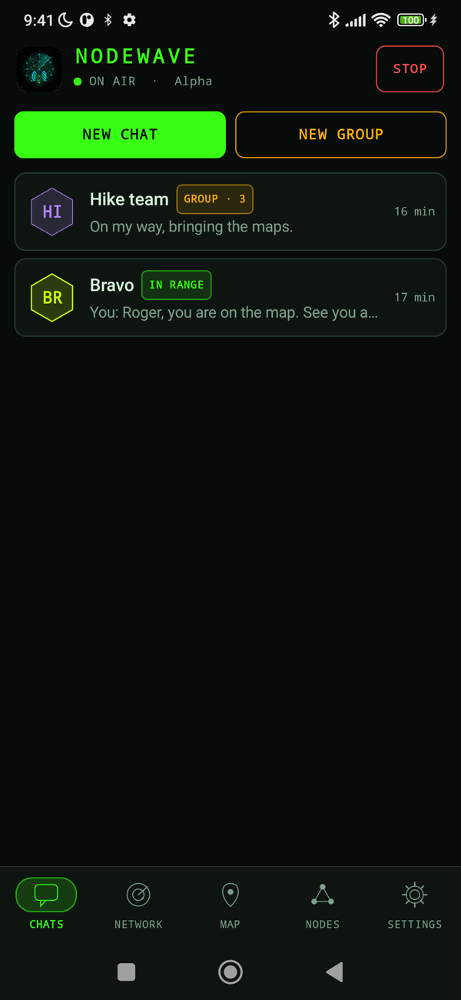
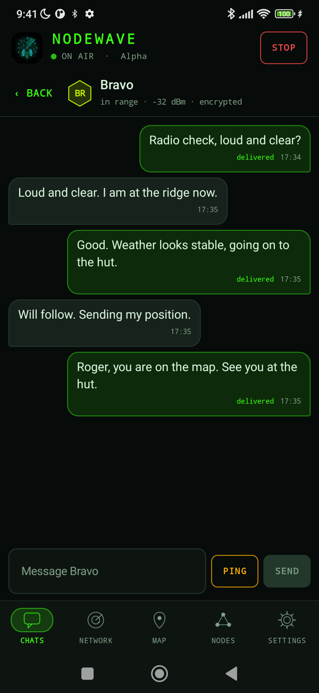
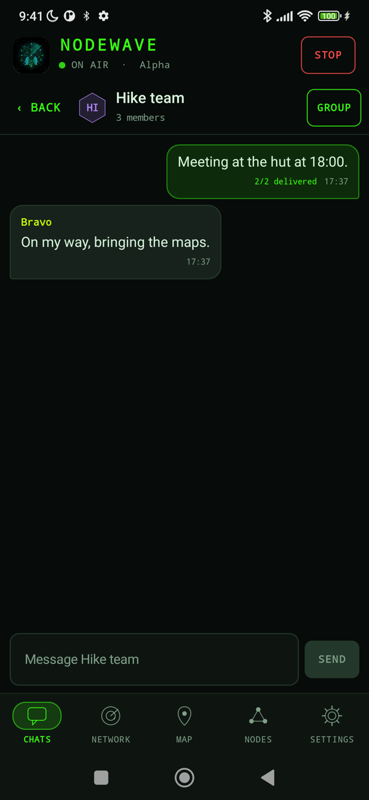
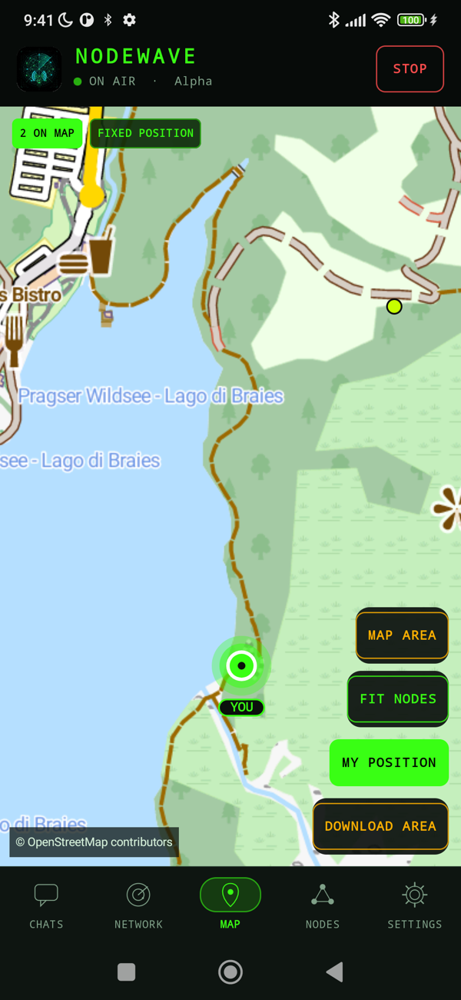
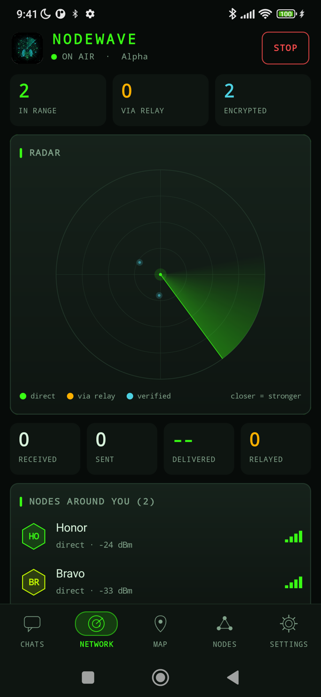
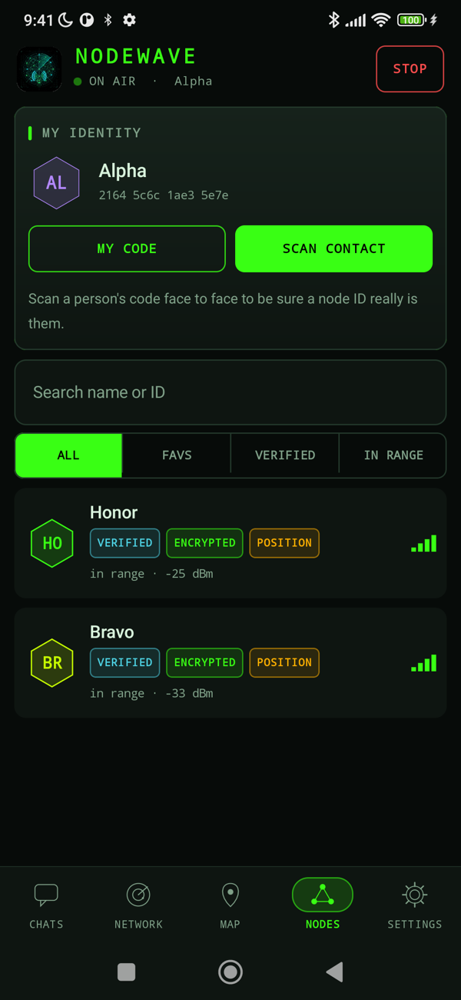
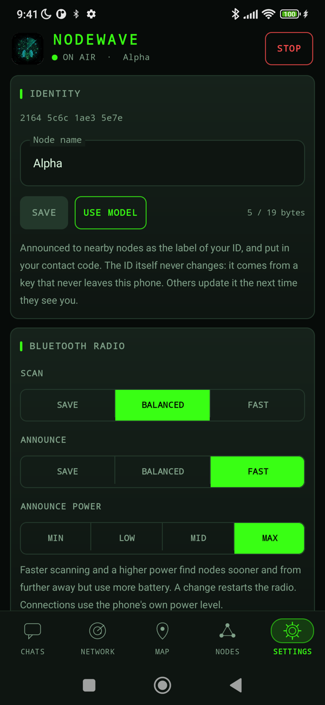
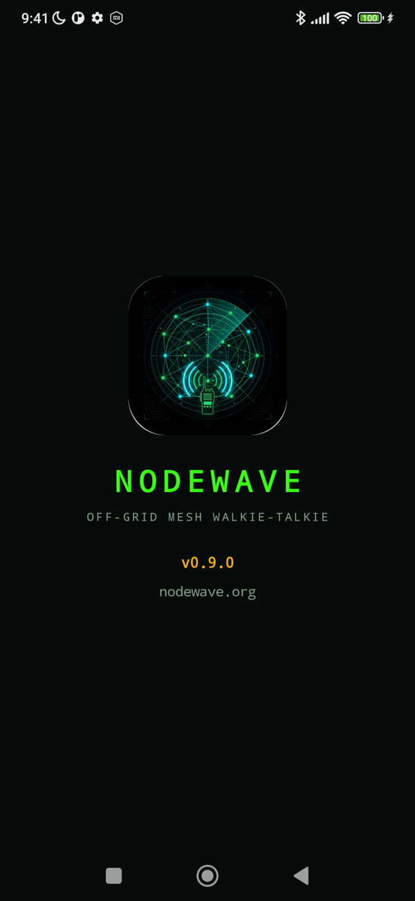

<p align="center"></p>

# NodeWave

Off-grid mesh walkie-talkie for Android. Phones talk to each other directly over **Bluetooth Low Energy**: no internet, no servers, no Google Play Services. 100% native Android APIs, ready for F-Droid.

**Status: v0.12.0** - phones discover each other, exchange **end-to-end encrypted, forward-secret** chat messages with delivery confirmation over pure BLE, relay them across intermediate phones (multi-hop), keep the radio running with the screen off, and remember the conversation. See the [changelog](CHANGELOG.md).

## Screenshots

<p align="center">




</p>
<p align="center">




</p>

Taken on real phones talking over Bluetooth (the two nodes on the map are given a fixed position on a hiking trail for the picture). Website: [nodewave.org](https://nodewave.org) (source in [`docs/`](docs/SITE.md)).

## Features (v0.12.0)

- Each node is at once a GATT server, advertiser, scanner and on-demand GATT client.
- Identity key pair per install; the node ID is derived from the public key, so peers are recognised even when BLE addresses rotate and an ID cannot be claimed by someone without the key.
- End-to-end encryption with **forward secrecy**: a signed ephemeral ECDH handshake (P-256, ECDSA, HKDF-SHA256) gives each pair of nodes AES-256-GCM session keys that live in memory only and are replaced every hour or 500 messages. Relays and eavesdroppers cannot read or alter messages, delivery receipts and neighbour announcements (HELLO) cannot be forged or replayed. See [docs/SECURITY.md](docs/SECURITY.md).
- Foreground service: the radio keeps working with the screen off or the app closed (notification with a *Stop radio* action).
- Reliable links: replies travel back on the connection that carried the request (GATT notifications), so a direct exchange needs one connection instead of several; unacknowledged messages are sent again; a watchdog restarts a scan or advertisement that silently died.
- **Verified contacts:** scan someone's QR code in person to confirm who a node ID belongs to; its key is then pinned.
- **Group chat** for up to 8 people, end-to-end encrypted per member (no shared group key), with an admin who manages the member list.
- **Position sharing and offline map:** share where you are with nobody, verified contacts or everyone in range; see nodes on an offline map (vector Mapsforge files, one file for a whole country, downloadable in the app). LoRa board settings are prepared for the USB boards coming later.
- **Voice messages** (up to 15 s) in one-to-one chats, sent as encrypted chunks with resend and delivery confirmation; Opus over Bluetooth and Codec2 (700-3200 bit/s) for slow links, links are classed slow/medium/fast so a relay refuses what its next link cannot carry.
- **Photos** and a **Wi-Fi Direct fast link** for them: Bluetooth finds the other phone and sets the link up (sealed), the photo then crosses at Wi-Fi speed; photos are stripped of EXIF and refused on slow links.
- Persistent chat history (message text encrypted at rest with the Android Keystore) with a CLEAR button.
- Live list of nodes: direct ones with signal strength (RSSI, dBm), indirect ones as `via <neighbour>`.
- Multi-hop relay with TTL and duplicate suppression; delivery ACKs travel back across the relays.
- Free-text chat to a selected node or to all nodes, with delivery status (`sent` / `DELIVERED` / `FAILED`), plus the number of relays crossed.
- Per-node ping and broadcast of "CIAO - 73".
- On-screen `MESH_RADIO` log console.

## Requirements

- Android 10 or later (`minSdk 29`, `targetSdk 35`) with Bluetooth LE.
- Android 10/11: location services must be switched **on** or the system returns no scan results.
- To build: JDK 17+ (the one bundled with Android Studio works) and the Android SDK with platform 35, NDK 27.2 and CMake 3.22.1 (for the Codec2 library).

## Build and install

```sh
export JAVA_HOME="/Applications/Android Studio.app/Contents/jbr/Contents/Home"   # macOS example
./gradlew assembleDebug      # APK in app/build/outputs/apk/debug/
./gradlew installDebug       # installs on every connected device
```

On Xiaomi/MIUI, "Install via USB" may require a Mi account and a SIM; copy the APK to the phone and install it manually instead.

## Try it

1. Install on two phones and grant the requested permissions.
2. Tap **START RADIO** on both. Each should list the other under *NODES*.
3. Tap a node to select it, type a message and tap **SEND** (or **ALL** for everyone), or use **PING (CIAO - 73)**. The other phone shows it and the sender's chat marks it `DELIVERED`.
4. Follow the radio from a computer:

```sh
adb logcat -s MESH_RADIO
adb -s <serial> logcat -s MESH_RADIO   # with several devices connected
```

## Testing the relay (three phones)

1. Install the same version on all three phones and start the radio on each.
2. Wait a few seconds: the node list of every phone should show the other two (indirect ones appear after the first neighbour announcement).
3. Phones in the same room all see each other, so force the relay: on the **sender and the receiver** switch on *DEBUG: skip direct link (force relay)*, leaving the third phone as it is.
4. Send a message from the sender to the receiver. The receiver shows it with `1 relay` and the sender marks it `DELIVERED · 1 relay`.
5. Alternatively, switch Bluetooth off on the relay phone and watch the indirect node disappear (it can take up to a minute for a stale route to expire if the neighbour announcement was missed).

## Running with the screen off

Tap **START RADIO** once; a notification appears and the radio keeps running when you lock the phone or leave the app. Use **STOP RADIO** (or the notification action) to stop it. While the radio runs the service holds a partial wake lock (the CPU stays awake, which costs battery) so other phones can still connect to you.

**Some phone makers freeze background apps anyway**, and then nobody can reach you with the screen off (the sender sees `Timeout during write`). Check [dontkillmyapp.com](https://dontkillmyapp.com) for your model. Known cases:

- **Honor / Huawei (EMUI)**: the app is frozen when the screen turns off, even with a foreground service. Open *Settings > Apps > NodeWave > Battery > App launch*, switch to *Manage manually* and enable *Auto-launch*, *Secondary launch* and *Run in background*.
- **Xiaomi (MIUI)**: worked in testing on a Mi Note 10; if yours stops, set *Battery saver* to *No restrictions* for NodeWave and enable *Autostart*.

## Permissions

| API level | Runtime permissions | Manifest notes |
|---|---|---|
| 31+ (Android 12+) | `BLUETOOTH_SCAN`, `BLUETOOTH_ADVERTISE`, `BLUETOOTH_CONNECT` | `BLUETOOTH_SCAN` has `neverForLocation` |
| 29-30 (Android 10-11) | `ACCESS_FINE_LOCATION` | `BLUETOOTH`, `BLUETOOTH_ADMIN`, location capped at `maxSdkVersion="30"` |
| 33+ (Android 13+) | `POST_NOTIFICATIONS` (optional) | shows the foreground-service notification |

The app also declares `FOREGROUND_SERVICE` and `FOREGROUND_SERVICE_CONNECTED_DEVICE` (granted at install).

## Architecture

Clean MVVM in Kotlin and Jetpack Compose (Material 3), with Coroutines and Flow throughout.

```
com.nodewave.mesh
├── MainActivity.kt        Compose UI, permission requests
├── MainViewModel.kt       thin StateFlow adapter for the UI
├── NodeWaveApp.kt         application: holds the process-wide MeshEngine
├── MeshEngine.kt          identity, storage, transport and messenger
├── RadioService.kt        foreground service that keeps the radio alive
├── crypto/                Crypto (ECDH, ECDSA, AES-GCM), SessionManager (handshake, sessions, rotation), Sealed, HandshakeMessage, LocalIdentity - pure JVM
├── data/                  stores (SQLite), Keystore cipher, interfaces
├── protocol/
│   ├── Packet.kt              24-byte header wire format (MESSAGE / PING / ACK / HELLO / KEY)
│   ├── Router.kt              next-hop selection (direct, route, flood)
│   ├── RoutingTable.kt        routes learned from neighbours' HELLOs
│   ├── HelloPayload.kt        neighbour list carried by HELLO
│   ├── NodeAdvertisement.kt   node ID + name in the BLE scan response
│   ├── NodeIdentity.kt        persisted stable node ID
│   └── MeshMessenger.kt       handshakes, sealing, relay, seen-cache, ACKs and resends, HELLOs, history
└── transport/
    ├── MeshTransport.kt   hardware-agnostic radio contract
    ├── BleTransport.kt    pure-BLE implementation
    └── MeshLog.kt         unified MESH_RADIO logger
```

The UI never touches radio APIs; everything goes through `MeshTransport`, and `MeshMessenger` adds the protocol on top without knowing about BLE. See [CLAUDE.md](CLAUDE.md) for the full rules (permissions, concurrency, timeouts, logging).

## Roadmap

- **v0.6.0** - to be planned (ideas: signed release builds for F-Droid, node-ID verification by QR code, group messages).

## Tests

```sh
./gradlew testDebugUnitTest   # crypto, codec, routing and an in-memory encrypted multi-node mesh simulation
```

## License

NodeWave is free software under the [GNU General Public License v3.0](LICENSE).
